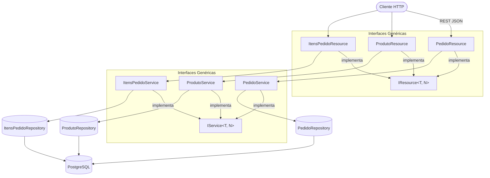

# api-gestao-pedidos

API REST para gerenciamento de pedidos, produtos e itens de pedido — construída com Java 17 e Spring Boot, seguindo arquitetura em camadas com interfaces genéricas, DTOs, logging estruturado e documentação Swagger completa.

[](https://openjdk.org/projects/jdk/17/)
[](https://spring.io/projects/spring-boot)
[](https://www.postgresql.org/)
[](http://localhost:8080/swagger-ui.html)
[](LICENSE)

---

## Arquitetura



---

## Destaques Técnicos

### Interfaces Genéricas
Toda a camada de controller e service é contratada por interfaces genéricas reutilizáveis:

```java
// Qualquer resource implementa este contrato
public interface IResource<T, N> {
    T create(T entity);
    T get(N id);
    List<T> get();
    T update(N id, T entity);
    void delete(N id);
}
```
Isso garante padronização e facilita a adição de novos recursos sem reescrever estrutura.

### Logging Estruturado
Todos os endpoints registram logs em dois níveis:
```java
log.info("PedidoResource::create");       // rastreabilidade em produção
log.debug("Valores: {}", entity);          // detalhamento em desenvolvimento
```

### Swagger Completo
Cada endpoint documenta resposta por código HTTP:
```java
@ApiResponses(value = {
    @ApiResponse(responseCode = "200", description = "Pedido criado com sucesso"),
    @ApiResponse(responseCode = "422", description = "Dados inválidos"),
    @ApiResponse(responseCode = "500", description = "Erro interno")
})
```

### Configuração 12-Factor
O `application.yaml` usa variáveis de ambiente com fallback — nunca quebra em desenvolvimento, mas é seguro em produção:
```yaml
datasource:
  url: ${DATABASE_JDBC_URL:jdbc:postgresql://localhost:5433/postgres}
  username: ${DATABASE_USERNAME:postgres}
  password: ${DATABASE_PASSWORD:changeme}
```

---

## Stack

| Tecnologia | Versão | Uso |
|---|---|---|
| Java | 17 | Linguagem principal |
| Spring Boot | 3.3.4 | Framework web |
| Spring Data JPA | — | Persistência ORM |
| PostgreSQL | — | Banco de dados relacional |
| Lombok | — | `@Getter`, `@Setter`, `@Slf4j` |
| Springdoc OpenAPI | 2.6.0 | Swagger UI automático |

---

## Como Executar

### Pré-requisitos

- Java 17 (JDK)
- Docker e Docker Compose (opcional, para execução via contêiner)

### Com Docker (recomendado)

```bash
git clone https://github.com/odavid062/api-gestao-pedidos.git
cd api-gestao-pedidos
docker compose up --build
```

| Serviço | URL |
|---|---|
| API | http://localhost:8080 |
| Swagger UI | http://localhost:8080/swagger-ui.html |
| PostgreSQL | localhost:5432 |

### Com Maven

No Linux/macOS:
```bash
cd demo
./mvnw spring-boot:run
```

No Windows:
```cmd
cd demo
mvnw.cmd spring-boot:run
```

> Configure as variáveis de ambiente `DATABASE_JDBC_URL`, `DATABASE_USERNAME` e `DATABASE_PASSWORD` ou use os valores padrão do `application.yaml`.

### Testes

Para rodar a suíte de testes com o Maven Wrapper:

No Linux/macOS:
```bash
cd demo
./mvnw test
```

No Windows:
```cmd
cd demo
mvnw.cmd test
```

---

## Variáveis de Ambiente

As configurações de conexão e runtime podem ser definidas via variáveis de ambiente no `.env` (usado pelo Docker Compose) ou passadas diretamente para a aplicação Spring Boot:

| Variável | Descrição | Onde é utilizada | Valor padrão / Fallback |
|---|---|---|---|
| `DB_USER` | Usuário do banco de dados PostgreSQL | Docker Compose (`db`, `api`) | `postgres` |
| `DB_PASSWORD` | Senha do usuário do PostgreSQL | Docker Compose (`db`, `api`) | `changeme` |
| `DB_NAME` | Nome do banco de dados PostgreSQL | Docker Compose (`db`, `api`) | `postgres` |
| `DATABASE_JDBC_URL` | URL JDBC de conexão com o banco | Spring Boot (`application.yaml`) | `jdbc:postgresql://localhost:5433/postgres` |
| `DATABASE_USERNAME` | Usuário de autenticação no banco | Spring Boot (`application.yaml`) | `postgres` |
| `DATABASE_PASSWORD` | Senha de autenticação no banco | Spring Boot (`application.yaml`) | `120210` |
| `SPRING_OUTPUT_ANSI_ENABLE` | Modo de cores ANSI no console | Spring Boot (`application.yaml`) | `always` |
| `SPRING_BANNER_CHARSET` | Codificação de caracteres do banner | Spring Boot (`application.yaml`) | `UTF-8` |
| `SPRING_BANNER_LOCATION` | Localização do arquivo de banner | Spring Boot (`application.yaml`) | `classpath:/banner.txt` |
| `SPRING_DRIVER_CLASS_NAME` | Classe do driver JDBC PostgreSQL | Spring Boot (`application.yaml`) | `org.postgresql.Driver` |

---

## Endpoints

### Pedidos — `/api/pedidos`

| Método | Rota | Descrição |
|---|---|---|
| `POST` | `/api/pedidos` | Cria novo pedido |
| `GET` | `/api/pedidos` | Lista todos os pedidos |
| `GET` | `/api/pedidos/{id}` | Busca pedido por ID |
| `PUT` | `/api/pedidos/{id}` | Atualiza pedido |
| `DELETE` | `/api/pedidos/{id}` | Remove pedido |

### Produtos — `/api/produtos`

| Método | Rota | Descrição |
|---|---|---|
| `POST` | `/api/produtos` | Cadastra produto |
| `GET` | `/api/produtos` | Lista todos os produtos |
| `GET` | `/api/produtos/{id}` | Busca produto por ID |
| `PUT` | `/api/produtos/{id}` | Atualiza produto |
| `DELETE` | `/api/produtos/{id}` | Remove produto |

### Itens de Pedido — `/api/itens`

| Método | Rota | Descrição |
|---|---|---|
| `POST` | `/api/itens` | Adiciona item |
| `GET` | `/api/itens` | Lista todos os itens |
| `GET` | `/api/itens/{id}` | Busca item por ID |
| `PUT` | `/api/itens/{id}` | Atualiza item |
| `DELETE` | `/api/itens/{id}` | Remove item |

### Exemplo

```bash
# Criar pedido
curl -X POST http://localhost:8080/api/pedidos \
  -H "Content-Type: application/json" \
  -d '{"datPedido": "2025-05-14T10:00:00", "itensPedido": []}'

# Listar produtos
curl http://localhost:8080/api/produtos
```

---

## Estrutura do Projeto

```
.
├── docker-compose.yml         # Orquestração dos containers (API e PostgreSQL)
├── Dockerfile                 # Multi-stage build da aplicação Java
├── .env.example               # Exemplo de variáveis de ambiente
└── demo/
    ├── pom.xml                # Configurações do Maven e dependências
    ├── mvnw / mvnw.cmd        # Executáveis do Maven Wrapper
    └── src/
        ├── main/
        │   ├── java/com/example/demo/
        │   │   ├── interfaces/
        │   │   │   ├── IResource.java         # Contrato genérico para controllers (CRUD)
        │   │   │   └── IService.java          # Contrato genérico para services (CRUD)
        │   │   ├── model/
        │   │   │   ├── PedidoModel.java       # Entidade JPA: nroPedido, datPedido
        │   │   │   ├── ProdutoModel.java      # Entidade: idProduto, desPro, qtdeProduto, valProduto
        │   │   │   └── ItensPedidoModel.java  # Entidade JPA: id, qtdeItem, valUnidade
        │   │   ├── Dto/
        │   │   │   ├── PedidoDto.java         # DTO com lista de ItensPedidoDto
        │   │   │   ├── ProdutoDto.java
        │   │   │   └── ItensPedidoDto.java
        │   │   ├── repository/
        │   │   │   ├── PedidoRepository.java
        │   │   │   ├── ProdutoRepository.java
        │   │   │   └── ItensPedidoRepository.java
        │   │   ├── service/
        │   │   │   ├── PedidoService.java     # Implementa IService<PedidoDto, Integer>
        │   │   │   ├── ProdutoService.java
        │   │   │   └── ItensPedidoService.java
        │   │   ├── resource/
        │   │   │   ├── PedidoResource.java    # Implementa IResource<PedidoDto, Integer>
        │   │   │   ├── ProdutoResource.java
        │   │   │   └── ItensPedidoResource.java
        │   │   └── exception/
        │   │       ├── CustomErrorException.java
        │   │       └── CustomHttpException.java
        │   └── resources/
        │       └── application.yaml   # Configurações do Spring Boot e datasource
        └── test/
            └── java/com/example/demo/
                └── DemoApplicationTests.java  # Testes de contexto da aplicação
```

---

## Documentação Interativa

```
http://localhost:8080/swagger-ui.html
```

---

## Autor

**David Rodrigues**
[](https://github.com/odavid062)
